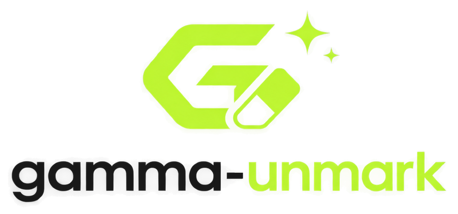

<div align="center">

<picture>
  <source media="(prefers-color-scheme: dark)" srcset="assets/logo-dark.png">
  
</picture>

**Drop. Clean. Save.**
Remove the "Made with Gamma" badge from exported `.pptx` and `.pdf` files, locally in your browser.


</div>

---

## ⚠️ Export first

`gamma-unmark` works on **exported files only**. It cannot read a Gamma page or share link directly.

In Gamma, export your presentation as **one of these formats**:

| Format | Supported |
| --- | :---: |
| **PowerPoint (.pptx)** | ✅ |
| **PDF (.pdf)** | ✅ |
| PNG / images | ❌ |
| Google Slides | ❌ |
| gamma.app link | ❌ |

Then drop the exported file into the app.

## Features

- 🖤 Minimal local web UI, drag & drop one or many files
- 🧠 PDF engine: [PyMuPDF](https://pymupdf.readthedocs.io/) (MuPDF)
- 💾 Choose where to save each cleaned file
- 🔒 Runs locally, your files never leave your machine
- 🎨 Layout, fonts and animations stay untouched

## Install

```bash
git clone https://github.com/rmznv-dev/gamma-unmark.git
cd gamma-unmark
pip install -r requirements.txt
```

Requires **Python 3.8+**. The only dependency is `pymupdf` (needed for PDF; PPTX works without it).

## Run

```bash
python gu.py
```

On Linux/macOS use `python3 gu.py`. On Windows `python gu.py` or `py gu.py`.

Your browser opens at `http://127.0.0.1:8765`. Then:

1. Drop your exported `.pptx` / `.pdf` file(s) or click to browse
2. Wait a moment
3. Click **Save as…** and pick a folder

Cleaned files are named `<original>_clean.pptx` / `<original>_clean.pdf`.

### Options

| Flag | Description |
| --- | --- |
| `--port 9000` | Use a different port (default `8765`) |
| `--no-browser` | Don't open the browser automatically |

## How it works

**PDF.** On every page the app finds the badge area: the clickable `gamma.app` link (fallback: the text "Made with Gamma"). Inside that area it deletes small images and redacts text and vector shapes, including those nested inside other objects. Then it removes the link and re-renders the area to verify that something really changed. The rest of the page is not touched.

**PPTX** is a ZIP of XML files. Slides, layouts and masters are scanned and the shapes/images that form the badge are removed (text "Made with Gamma", elements linked to `gamma.app`, pictures named after Gamma).

## Notes & limitations

- If the badge is baked into a large background image, there is nothing separate to remove. The status will say *"badge graphic not detected"* (the link is still removed).
- Encrypted PDFs are not supported. PNG exports can't be cleaned.
- Gamma can change how it exports at any time, which may break detection. Open an issue with a sample file if a case is missed.
- PyMuPDF is licensed under AGPL-3.0 (or commercially by Artifex). It is installed separately via pip and not bundled in this repository.
- "Save as…" uses the browser's native file picker (Chrome, Edge, Opera). In Firefox/Safari the file goes to your downloads folder; enable *"Always ask where to save files"* to get a dialog.
- The server listens on `127.0.0.1` only and rejects requests from other websites.

## Disclaimer

**This project is provided for educational and research purposes only**, to study how presentation and PDF file formats are structured.

- The software is provided **"as is"**, without warranty of any kind. The author(s) and contributors are **not responsible or liable** for how it is used, or for any damage, loss, account restriction, legal claim or other consequence arising from its use.
- **You alone are responsible** for your actions. Use it only on files you own or have the right to modify, and make sure your use complies with the terms of service of the platform you exported from, copyright law and any other laws that apply to you.
- This project does not encourage or condone violating any service's terms or anyone's rights. If you want the badge removed in a supported way, check the official plans of the service.
- This project is **not affiliated with, endorsed by or sponsored by** Gamma Tech, Inc. "Gamma" and related names are trademarks of their respective owners and are used here only to describe compatibility.
- If you are a rights holder and have a concern about this project, please open an issue.

## License

MIT, see [LICENSE](LICENSE).
